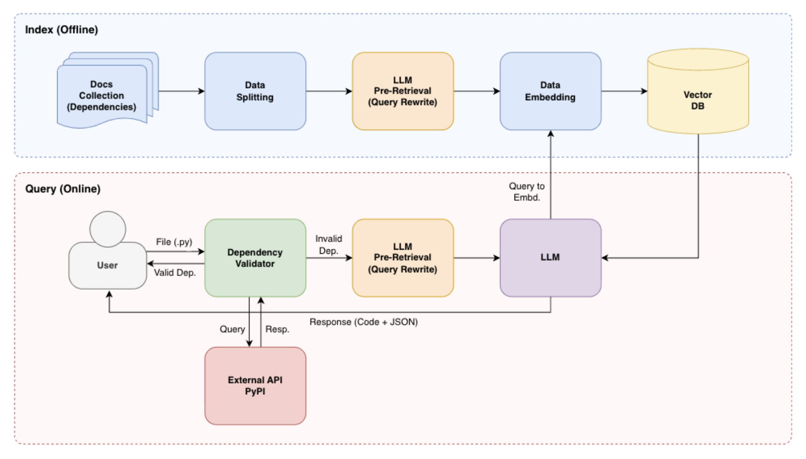

# 73.69 - Large Language Models

**Trabajo Práctico N°3**
**Instituto Tecnológico de Buenos Aires**

**Grupo 7**

**Integrantes:**

- Barnatán, Martín Alejandro (64463)
- Cantarella, Juan Ignacio (64509)
- Pedemonte Berthoud, Ignacio (64908)

**Fecha de Entrega:** 07/10/2026

---

## Tabla de Contenidos

1. Descripción del Problema
2. Input y Output
3. Fuente de Datos y Formato
4. Base de Datos Vectorial
5. Alcance Inicial y Desafíos
6. Diagrama de Arquitectura
7. Bibliografía

---

## 1. Descripción del Problema

La generación de código asistida por LLMs presenta riesgos debido a la característica probabilística de su memoria paramétrica y a la falta de verificación. Esta debilidad se manifiesta, en primer lugar, en la alucinación de dependencias, que se produce cuando los modelos inventan nombres de librerías inexistentes en registros como PyPI. Esto posibilita ataques de *slopsquatting*, donde actores maliciosos registran dichos nombres con malware para infectar la cadena de suministro de software. Además, existe otro problema de obsolescencia debido al Knowledge Cutoff. Como la fecha de corte del entrenamiento del LLM es estática, el modelo puede sugerir paquetes deprecados o desactualizados, así como dependencias abandonadas con vulnerabilidades conocidas. Esto podría presentar también una fuente de vulnerabilidades para las aplicaciones desarrolladas.

Como solución a esta problemática, se propone la adopción de una arquitectura basada en Retrieval-Augmented Generation (RAG) que frente a una entrada de código Python, obtenga imports y, ante dependencias deprecadas o inexistentes, aplique el pipeline de recuperación sobre memoria no paramétrica con documentación y metadatos curados de paquetes reales. De esta forma, el generador produce una salida con el código actualizado con las dependencias libres de problemáticas.

## 2. Input y Output

El input de la aplicación consiste en código fuente en texto plano, el cual el usuario debe proveer como un archivo Python (`.py`). En él, se encuentran las declaraciones de las dependencias junto con el o los bloques de código donde las mismas son invocadas. Como output de la aplicación, el usuario debe obtener un resultado estructurado conformado por dos elementos complementarios. En primer lugar, se debe retornar el script de Python corregido con la implementación correcta de las dependencias necesarias. En segundo lugar, el usuario debe recibir un reporte en formato JSON con el detalle de las dependencias analizadas, el motivo de reemplazo de cada una de ellas y la opción implementada para sustituirla. Cuando no se encuentra un candidato con suficiente confianza, la dependencia se marca como "sin reemplazo confiable" y el código no se modifica.

## 3. Fuente de Datos y Formato

El conocimiento no paramétrico se construye a partir de la documentación de un conjunto acotado de 100 librerías populares de Python, seleccionadas a partir del listado de paquetes más descargados de PyPI y en función de la disponibilidad de material procesable. A partir de sus repositorios oficiales, se extraen distintas secciones para indexar la funcionalidad y la sintaxis de cada librería como descripciones y ejemplos. Se utiliza además la API de PyPI como fuente de consulta para analizar si las dependencias del fragmento recibido son alucinadas o están deprecadas, pero los resultados no se indexan, es únicamente una capa de verificación.

La documentación original obtenida se segmenta tomando un splitter consciente de la estructura, es decir, que conserve los bloques de código y los títulos de sección. Cada chunk se compone de un fragmento de uso con su correspondiente descripción. A su vez, se incorpora una breve explicación en lenguaje natural generada por un LLM que se convertirá en embedding. Esto permitirá que la consulta del usuario, que también atravesará un proceso de Query Rewriting para obtener su explicación en lenguaje natural, y la descripción obtenida se comparen en el mismo tipo de texto, mientras que el fragmento de código se guarda asociado para ser utilizado luego en la generación de la respuesta.

## 4. Base de Datos Vectorial

En la base de datos vectorial se persiste un registro por cada caso de uso obtenido de la documentación. Cada uno contiene el **embedding** (vector de la descripción en lenguaje natural generada por el LLM), un **snippet** (fragmento de código de ejemplo), la **explicación** original de la documentación y **metadatos** (como paquete, nombre de import, versión, fecha de release, etc.). Esto último permite filtrar los paquetes deprecados o desactualizados antes de la búsqueda y determinar la librería a tomar a partir de los chunks recuperados.

## 5. Alcance Inicial y Desafíos

La arquitectura propuesta se limita únicamente a código Python de un único archivo y a las 100 librerías indexadas que funcionan como fuente de reemplazo. Sin embargo, la validación contra PyPI contempla todo el registro de dependencias, por lo que pueden existir casos en los que la base de datos no contenga un candidato funcional. Se abordarán tanto casos de dependencias inexistentes (posiblemente alucinadas) como deprecadas.

Entre los principales desafíos se encuentra la diferencia de estructuración de la documentación de las distintas librerías, lo que exige implementar adaptadores y realizar una selección de librerías que permita tener un sistema funcional. Además, la cercanía semántica no garantiza que un ejemplo resuelva lo mismo, por lo que se debe implementar un umbral de confianza. Por último, se tiene la brecha semántica entre la consulta y la documentación, lo que motiva el uso de Query Rewriting.

## 6. Diagrama de Arquitectura

**Figura 1.** Diagrama de Arquitectura

## 7. Bibliografía

1. **Lewis, P., Perez, E., Piktus, A., Petroni, F., Karpukhin, V., Goyal, N., Küttler, H., Lewis, M., Yih, W., Rocktäschel, T., Riedel, S., & Kiela, D. (2020).** Retrieval-Augmented Generation for Knowledge-Intensive NLP Tasks. Advances in Neural Information Processing Systems (NeurIPS), 33, 9459–9474.
2. **Luchs, H., & Al-Hassani, Y. (2024).** Names Can Hurt: Spotting and Mitigating Package Hallucinations in LLM-Generated Code. arXiv preprint arXiv:2408.01234.
